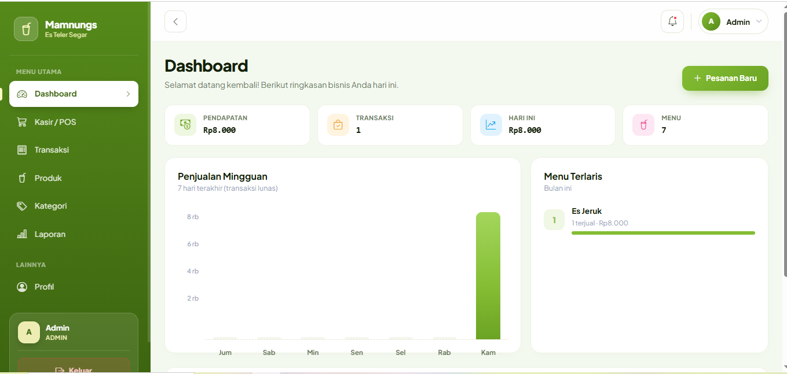
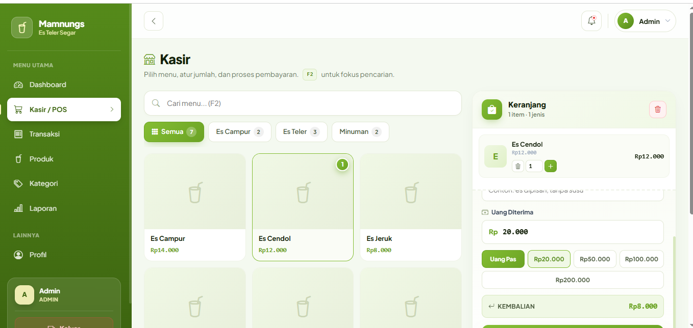
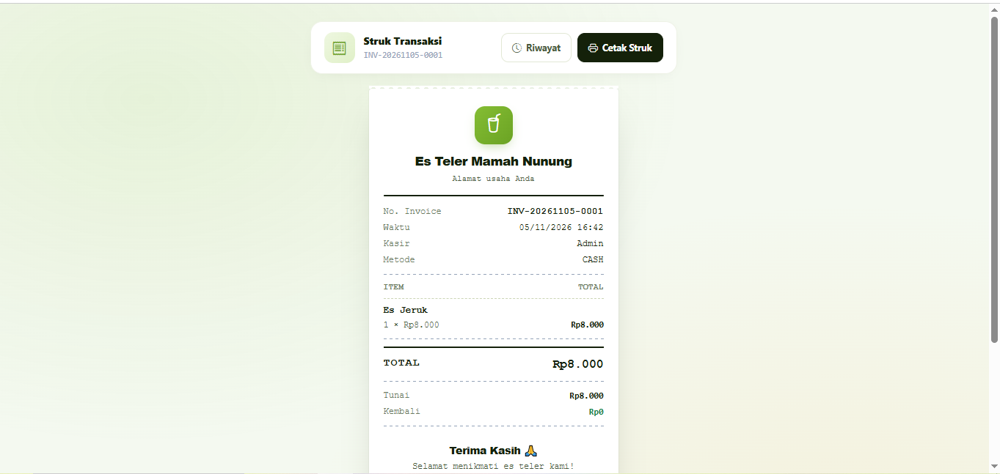
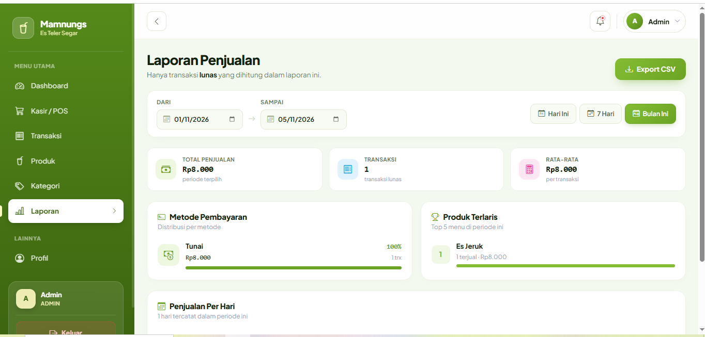
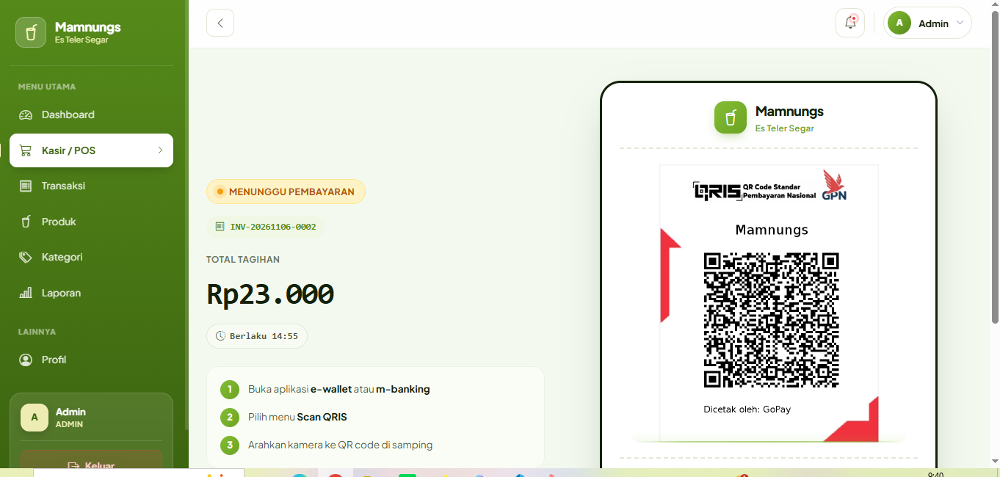

# Mamnungs POS (Angular + .NET)

Aplikasi kasir (Point of Sale) berbasis web untuk usaha UMKM Es Teler. Frontend dibangun dengan **Angular**, backend dengan **ASP.NET Core Web API**, dan data disimpan di **SQLite** lewat **Entity Framework Core**. Hak akses dibagi menjadi **admin** dan **kasir** menggunakan **JWT**. Sistem pembayaran mendukung **Tunai** dan **QRIS (Midtrans)**.


## Screenshot

| Dashboard Admin | Kasir (POS) |
|---|---|
|  |  |

| Struk | Laporan |
|---|---|
|  |  |

| Pembayaran QRIS |
|---|
|  |

## Fitur

### Kasir
- Menu produk dengan pencarian dan filter kategori
- Keranjang: tambah, ubah jumlah, hapus item, catatan pesanan
- **Pembayaran Tunai**: uang diterima, tombol uang pas, kembalian otomatis
- **Pembayaran QRIS (Midtrans)**: generate QR dinamis, pengecekan status otomatis (auto-polling), dan auto-redirect ke struk setelah lunas
- Struk siap cetak (format thermal 58 mm)
- Riwayat transaksi milik sendiri, difilter per tanggal

### Admin
- Dashboard: pendapatan dan transaksi bulan ini (dibanding bulan lalu), penjualan hari ini, grafik 7 hari, menu terlaris, transaksi terbaru
- Manajemen **kategori** dan **produk** (foto, harga, status tersedia/habis, pencarian, filter, pagination)
- **Laporan** penjualan dengan filter tanggal, rincian per metode pembayaran, produk terlaris, dan export CSV
- Melihat riwayat transaksi semua kasir

### Keamanan dan hak akses
- Login JWT; token dikirim otomatis oleh HTTP interceptor
- Pembatasan akses di dua lapis: **route guard** di Angular dan **`[Authorize(Roles = ...)]`** di API
- Kasir tidak bisa membuka halaman atau endpoint admin, dan tidak bisa melihat struk milik orang lain (403)
- Akun nonaktif ditolak saat login
- Password disimpan sebagai hash BCrypt

## Keputusan desain

- **Harga tidak pernah dipercaya dari browser.** Frontend hanya mengirim `productId` dan `quantity`; server mengambil harga dari database dan menghitung total sendiri.
- **Nama dan harga produk disalin ke `OrderItems`**, sehingga transaksi lama tetap menampilkan harga saat itu walau harga produk berubah.
- **Order, item, dan pembayaran disimpan dalam satu transaksi database** (satu `SaveChanges`): semua tersimpan atau tidak sama sekali.
- **Nomor invoice** (`INV-YYYYMMDD-0001`) memakai tanggal Jakarta dan dijaga *unique index*; jika dua kasir bentrok, server mencoba nomor berikutnya.
- **Produk memakai soft delete** (`IsDeleted` dengan global query filter) agar riwayat transaksi tidak rusak.
- **Waktu disimpan sebagai UTC** dan ditampilkan sebagai WIB; filter tanggal memakai batas hari Jakarta.
- **Hanya transaksi `PAID`** yang dihitung sebagai penjualan.
- **Upload foto** divalidasi (JPG/PNG/WebP, maks. 2 MB) dan disimpan dengan nama acak.
- **Export CSV** memakai UTF-8 BOM (terbaca benar di Excel) dan nilai diamankan dari injeksi rumus.
- **Integrasi Midtrans** menggunakan arsitektur *webhook/callback* yang aman. Status pesanan di-update secara *real-time* via polling dari frontend, dan nominal pembayaran divalidasi ulang di backend.

## Tech stack

| Bagian | Teknologi |
|---|---|
| Frontend | Angular (standalone components, signals, reactive forms, lazy routes) |
| UI | Bootstrap 5 + Bootstrap Icons |
| Backend | ASP.NET Core Web API (controllers) |
| ORM dan database | Entity Framework Core + SQLite |
| Autentikasi | JWT Bearer + BCrypt |
| Payment Gateway | Midtrans (Snap / Core API QRIS) |

## Arsitektur

```text
Angular SPA (localhost:4200)
   │  HttpClient + auth interceptor (Bearer token)
   ▼
ASP.NET Core API (localhost:5080)
   │  EF Core
   ▼
SQLite (backend/mamnungs.db)
   │
   ▼
Midtrans Payment Gateway (API)

## Alur checkout

```text
Kasir pilih produk → keranjang → bayar tunai
        │
        ▼
POST /api/pos/checkout  { items: [{productId, quantity}], amountReceived, notes }
        │
        ├─ ambil harga dari database (bukan dari browser)
        ├─ validasi: produk tersedia, uang cukup
        ├─ buat Order + OrderItems (salinan nama dan harga) + Payment
        └─ kembalikan nomor invoice dan kembalian
```

## Menjalankan proyek

### Kebutuhan

- [.NET SDK](https://dotnet.microsoft.com/download) (cek dengan `dotnet --version`)
- [Node.js](https://nodejs.org) dan npm
- Angular CLI: `npm install -g @angular/cli`
- Alat EF Core (hanya jika membuat migration baru): `dotnet tool install --global dotnet-ef`

### 1. Clone

```bash
git clone https://github.com/USERNAME/mamnungs-dotnet.git
cd mamnungs-dotnet
```

### 2. Jalankan backend

```bash
cd backend
dotnet run --urls http://localhost:5080
```

Saat pertama kali berjalan, database `mamnungs.db` dibuat otomatis lewat migration dan diisi data contoh (akun, kategori, produk). Tidak ada langkah database manual.

### 3. Jalankan frontend (terminal kedua)

```bash
cd frontend
npm install
ng serve
```

Buka **http://localhost:4200**.

### Akun demo

> Hanya untuk demo dan pengembangan. Ganti sebelum dipakai di server sungguhan.

| Role | Email | Password |
|---|---|---|
| Admin | `admin@mamnungs.test` | `password` |
| Kasir | `kasir@mamnungs.test` | `password` |

### Konfigurasi

| Pengaturan | Lokasi |
|---|---|
| Alamat API untuk frontend | `frontend/src/app/core/config.ts` |
| Nama dan alamat toko di struk | `backend/appsettings.json` (bagian `Store`) |
| Kunci JWT | `backend/appsettings.Development.json` (hanya development) |
| Connection string | `backend/appsettings.json` (bagian `ConnectionStrings`) |

Untuk produksi, kunci JWT **jangan** disimpan di file; isi lewat environment variable:

```bash
Jwt__Key="kunci-acak-minimal-32-karakter"
```

## Endpoint API

| Method | Endpoint | Akses | Fungsi |
|---|---|---|---|
| POST | `/api/auth/login` | Publik | Login, mengembalikan token JWT |
| GET | `/api/auth/me` | Login | Data pengguna saat ini |
| GET | `/api/categories` | Login | Daftar kategori |
| POST/PUT/DELETE | `/api/categories` | Admin | Tambah, ubah, hapus kategori |
| GET | `/api/products` | Login | Daftar produk (cari, filter, pagination) |
| POST/PUT/PATCH/DELETE | `/api/products` | Admin | Tambah, ubah, ubah status, hapus produk |
| GET | `/api/pos/menu` | Kasir, Admin | Menu produk yang tersedia |
| POST | `/api/pos/checkout` | Kasir, Admin | Buat transaksi tunai |
| GET | `/api/orders` | Kasir, Admin | Riwayat transaksi (kasir: milik sendiri) |
| GET | `/api/orders/{id}` | Kasir, Admin | Data struk |
| GET | `/api/dashboard` | Admin | Statistik dashboard |
| GET | `/api/reports` | Admin | Laporan penjualan |
| GET | `/api/reports/export` | Admin | Export CSV |

## Struktur proyek

```text
mamnungs-dotnet/
├── backend/
│   ├── Controllers/     # Auth, Categories, Products, Pos, Orders, Dashboard, Reports
│   ├── Data/            # AppDbContext dan seeder
│   ├── Helpers/         # Clock (zona waktu), Slug, ekstensi user
│   ├── Migrations/
│   ├── Models/          # Entitas dan DTO
│   ├── Services/        # TokenService (JWT)
│   └── Program.cs
└── frontend/src/app/
    ├── core/            # Service, interceptor, guard, model, pipe
    ├── layout/          # Shell (sidebar dan topbar)
    └── pages/           # login, admin, kasir, transaksi
```

## Model data

```text
Users ──< Orders ──┬──< OrderItems >── Products >── Categories
                   └──  Payments
```

## Pengujian manual

1. Login sebagai kasir, buat transaksi (uang kurang ditolak, uang cukup berhasil), buka struk.
2. Ubah harga produk di admin, buka struk transaksi lama: harga lama tetap.
3. Tandai produk Habis di admin: produk hilang dari menu kasir.
4. Kasir membuka `/admin/dashboard` atau struk milik orang lain: ditolak.
5. Admin membuka dashboard dan laporan, cocokkan total dengan riwayat transaksi, lalu export CSV.

## Keterbatasan dan pengembangan lanjutan

- Pembayaran baru mendukung tunai; integrasi QRIS (payment gateway) belum ada.
- Manajemen pengguna lewat antarmuka belum ada; akun dibuat dari seeder.
- Belum ada pengujian otomatis (unit/integration test).
- Database SQLite cocok untuk demo; untuk produksi ganti provider EF Core ke SQL Server atau PostgreSQL.

## Lisensi

Belum ditentukan.